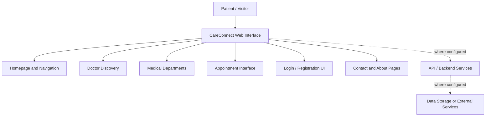

::: {align="center"}
# 🏥 CareConnect

### Better Care. Easier Appointments.

A modern healthcare appointment platform designed to help patients
discover doctors, explore medical specialties, and navigate the
appointment-booking journey through a clean, user-friendly interface.

[](https://care-connect-pi-umber.vercel.app/)
[](https://github.com/Jennifer-Vesilica-Rachel/care-connect)
:::

------------------------------------------------------------------------

## 📌 About the Project

**CareConnect** is a healthcare website concept built to make the
process of finding a doctor and exploring hospital appointment options
easier. It brings key healthcare information into one place and presents
it through a modern, approachable digital experience.

The project emphasizes clear navigation, accessible layouts, and a
consistent visual identity---helping users move from discovering a
medical specialty to exploring doctor details and the appointment flow.

### 🎯 Project Goal

To create a simple and welcoming digital experience that helps patients
find relevant healthcare information and begin the appointment-booking
process with less confusion.

> **Better Care. Easier Appointments.**

## ✨ Key Features

  -----------------------------------------------------------------------
  Feature                             Description
  ----------------------------------- -----------------------------------
  🏠 **Healthcare Landing Page**      Introduces CareConnect and provides
                                      clear entry points to key areas of
                                      the website.

  👨‍⚕️ **Find a Doctor**                Lets users explore doctor
                                      information and specializations.

  🩺 **Medical Departments**          Organizes healthcare services by
                                      specialty to help users identify
                                      relevant care.

  📅 **Appointment Flow**             Provides an interface for choosing
                                      a doctor and reviewing appointment
                                      details.

  👤 **Doctor Profiles**              Presents doctor information in a
                                      clear, organized layout.

  ℹ️ **About CareConnect**            Explains the platform's purpose and
                                      patient-focused approach.

  📞 **Contact Page**                 Gives visitors a place to find
                                      contact information or request
                                      assistance.

  🔐 **Account Screens**              Includes login and registration
                                      interfaces where implemented.

  📱 **Responsive UI**                Designed with a clean layout
                                      intended to work across common
                                      screen sizes.
  -----------------------------------------------------------------------

> **Note:** The availability of real authentication, database
> persistence, live appointment slots, and booking confirmations depends
> on the backend services configured for the deployed project. Do not
> use this prototype as a real patient-record system.

## 🖥️ Live Preview

Explore the deployed website:

**🔗 [Open CareConnect Live
Demo](https://care-connect-pi-umber.vercel.app/)**

### 📸 Screenshots

Add screenshots of the actual deployed application to your repository
(for example, in `public/images/` or a `screenshots/` folder), then
update the paths below.

  ------------------------------------------------------------------------------------------------------------
  Homepage                                              Find a Doctor
  ----------------------------------------------------- ------------------------------------------------------
  ``   ``

  ------------------------------------------------------------------------------------------------------------

  -------------------------------------------------------------------------------------------------------------------------
  Departments                                          Appointment Flow
  ---------------------------------------------------- --------------------------------------------------------------------
  ``   ``

  -------------------------------------------------------------------------------------------------------------------------

*Replace the example image paths with screenshots that exist in your
repository. Until then, GitHub will show the image paths as text.*

## 🧭 How It Works

1.  **Explore the homepage** --- learn about the CareConnect platform.
2.  **Find a doctor** --- browse available doctor profiles and
    specializations.
3.  **Explore departments** --- identify the relevant medical specialty.
4.  **Review doctor details** --- learn more about a selected doctor.
5.  **Start the appointment flow** --- choose appointment details where
    supported.
6.  **Review the information** --- check the selected details before
    proceeding.

The exact actions available depend on the features and services enabled
in the current deployment.

## 🏗️ Application Architecture

CareConnect uses a React-based frontend with Vite for development and
production builds. The repository also includes Express and Google GenAI
packages, which can support server-side/API and generative-AI
functionality when implemented and configured.



*The diagram is a high-level overview of the intended user journey. It
does not imply that a database, authentication provider, or external
hospital system is already connected.*

## 🛠️ Tech Stack

  -----------------------------------------------------------------------
  Technology                          Purpose
  ----------------------------------- -----------------------------------
  **React**                           Building reusable user-interface
                                      components

  **TypeScript**                      Adding type safety to JavaScript

  **Vite**                            Development server and production
                                      build tooling

  **Tailwind CSS**                    Styling and responsive layouts

  **React Router**                    Client-side page navigation, where
                                      configured

  **Lucide React**                    Icons for interface elements

  **Motion**                          UI animations and transitions

  **Express**                         Node.js web server/API framework,
                                      where used

  **Google GenAI SDK**                Google generative-AI integration,
                                      where configured

  **Git & GitHub**                    Version control and source-code
                                      hosting

  **Vercel**                          Deployment of the live website
  -----------------------------------------------------------------------

## 🎨 Design Direction

CareConnect follows a calm, modern healthcare visual direction intended
to communicate trust, clarity, and care.

  Design element   Color       Intended use
  ---------------- ----------- ----------------------------------
  Deep Navy        `#172B46`   Primary brand color and headings
  Warm Ivory       `#F7F4ED`   Backgrounds and light surfaces
  Muted Teal       `#56B7AD`   Accents and highlights
  White            `#FFFFFF`   Cards and content surfaces

### Design principles

-   Clear and intuitive navigation
-   Readable typography and visual hierarchy
-   Consistent spacing, colors, and components
-   Patient-friendly language and calls to action
-   Layouts designed to adapt to different screen sizes

## 📂 Project Structure

The repository includes a `public/images/` directory and a `src/`
directory. The outline below is a **guide to the main project areas**;
consult the repository for the exact current file names.

``` text
care-connect/
├── public/
│   └── images/           # Public images and visual assets
├── src/                  # React application source
├── .env.example          # Example environment configuration
├── .gitignore
├── index.html
├── package.json          # Dependencies and npm scripts
├── bun.lock              # Bun dependency lockfile
├── tsconfig.json         # TypeScript configuration
├── vite.config.ts        # Vite configuration
└── README.md
```

## 🚀 Getting Started

### Prerequisites

Install the following:

-   [Node.js](https://nodejs.org/) --- use a version compatible with the
    project dependencies
-   npm (included with Node.js)
-   [Git](https://git-scm.com/)
-   A code editor such as [Visual Studio
    Code](https://code.visualstudio.com/)

### 1. Clone the repository

``` bash
git clone https://github.com/Jennifer-Vesilica-Rachel/care-connect.git
cd care-connect
```

### 2. Install dependencies

``` bash
npm install
```

### 3. Configure environment variables

If your local setup requires API keys or other environment values, check
`.env.example` and create a local `.env` file with the required values.

``` bash
# Create a local environment file, then add the values required by your setup.
# Do not commit secrets or private API keys to GitHub.
```

Do not add real API keys to source code or commit your `.env` file.

### 4. Start the development server

``` bash
npm run dev
```

Open the local URL printed in the terminal. The current package script
uses port `3000`.

### 5. Build for production

``` bash
npm run build
```

### 6. Preview the production build

``` bash
npm run preview
```

### Available scripts

  -----------------------------------------------------------------------
  Command                             Description
  ----------------------------------- -----------------------------------
  `npm run dev`                       Starts the Vite development server
                                      on port 3000

  `npm run build`                     Builds the application for
                                      production

  `npm run preview`                   Serves the production build locally

  `npm run lint`                      Runs the TypeScript type-check
                                      command configured in the project
  -----------------------------------------------------------------------

## 🌐 Deployment

CareConnect is deployed on Vercel.

-   **Live website:** https://care-connect-pi-umber.vercel.app/
-   **Source code:**
    https://github.com/Jennifer-Vesilica-Rachel/care-connect

To deploy your own version, import the GitHub repository into Vercel,
configure any required environment variables in the Vercel project
settings, and deploy using the build settings appropriate for the
repository.

## 🔒 Security and Privacy

Healthcare-related applications may handle sensitive personal
information. Before using CareConnect with real patients, ensure that
the production implementation includes:

-   Secure authentication and authorization
-   Server-side validation of user input
-   Proper access controls for patient and appointment data
-   Secure handling of environment variables and API keys
-   Appropriate privacy safeguards and applicable legal compliance
-   Reliable storage, error handling, and monitoring

Use sample data for demos and testing. Do not enter real patient
information unless the application has been reviewed and approved for
that purpose.

## 🚧 Limitations and Future Enhancements

Potential next steps for the project include:

-   Connect appointment booking to a backend API and database
-   Add secure patient accounts and authentication
-   Display real-time doctor availability and appointment slots
-   Support booking confirmation, rescheduling, and cancellation
-   Add email or SMS appointment reminders
-   Create doctor and administrator dashboards
-   Add search and filtering by department or specialization
-   Improve accessibility and test usability across devices

These are possible enhancements, not claims that the features are
already implemented.

## 📁 Project Resources

-   **GitHub repository:**
    [care-connect](https://github.com/Jennifer-Vesilica-Rachel/care-connect)
-   **Live website:** [CareConnect on
    Vercel](https://care-connect-pi-umber.vercel.app/)
-   **Project assets and documentation:** [Google Drive
    folder](https://drive.google.com/drive/folders/1jfkH91QslRPuVtHws3GmCKInR2wdf4Nv?usp=drive_link)

## 👩‍💻 Author

**Jennifer Vesilica Rachel S**\
B.Tech --- Information Science & Engineering

GitHub:
[@Jennifer-Vesilica-Rachel](https://github.com/Jennifer-Vesilica-Rachel)

## 📄 License

This project is intended for educational and portfolio purposes. If you
plan to distribute it as open-source software, add a `LICENSE` file and
specify the license terms.

------------------------------------------------------------------------

::: {align="center"}
**CareConnect --- Better Care. Easier Appointments.**\
Made with ❤️ to make healthcare appointments easier.
:::
